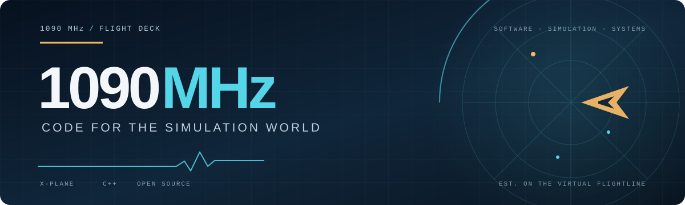

### C++ professional programmer by profession. Flight simulation enthusiast by passion.

Building tools for the virtual skies — from X-Plane plugins to developer utilities.

 

---

## 🛫 Hangar

| Project | What's on the ramp | Stack |
| :--- | :--- | :--- |
| [OpenXPUIPC](https://github.com/1090MHz/OpenXPUIPC) | Open-source XPUIPC-compatible offset emulation for X-Plane, powered by DataRefs. | C++ |
| [PreflightCheckLibs](https://github.com/1090MHz/PreflightCheckLibs) | Docker-based build environment for preflight check libraries. | Docker |
| [XPlaneUtilities](https://github.com/1090MHz/XPlaneUtilities) | C++ utilities for X-Plane development. | C++ |
| [X-Plane-Menu-Hugo](https://github.com/1090MHz/X-Plane-Menu-Hugo) | Hugo-based X-Plane menu site, published with GitHub Pages. | Hugo, HTML |
| [NeoSlider4XPlane](https://github.com/1090MHz/NeoSlider4XPlane) | Adafruit NeoSlider as an X-Plane control axis with LED feedback. | Python |
| [SkyImGui](https://github.com/1090MHz/SkyImGui) | Interactive airline-inspired ImGui theme generator, deployed on Netlify. | JavaScript, Hugo |

### More from the hangar

- [XPlaneOpenGLTrianglePlugin](https://github.com/1090MHz/XPlaneOpenGLTrianglePlugin) — Minimal modern OpenGL rendering in an X-Plane plugin.
- [fsuipc-protocol-tutorial](https://github.com/1090MHz/fsuipc-protocol-tutorial) — An FSUIPC protocol walkthrough in C++.

## 🎛️ Avionics Stack

- **Languages:** C++, Python, JavaScript, C
- **Tools & libraries:** X-Plane SDK, Dear ImGui, LVGL, OpenGL, Cairo, Docker, Hugo, Netlify
- **Platforms:** Windows, Linux

## 📡 Under the Radar

- Browse the [full fleet of repositories](https://github.com/1090MHz?tab=repositories).
- Open an issue on any project — collaboration and feedback are welcome.

## ⛽ Fuel the Work

If you find any of the projects useful, sponsorship is appreciated and helps fund ongoing maintenance and new work.

Enjoy the X-Plane projects? Check out the payware plugins developed by 1090MHz for [AeroSwank](https://store.aeroswank.com).

## 📊 The Six-Pack

*Flight telemetry from the codebase.*

<table>
  <tr>
    <td align="center" width="50%">
      <h3>Airspeed · Momentum</h3>
      
Contribution streaks

      
    </td>
    <td align="center" width="50%">
      <h3>Attitude · Overview</h3>
      
GitHub activity at a glance

      
    </td>
  </tr>
  <tr>
    <td align="center">
      <h3>Altimeter · Languages</h3>
      
Language mix by repository size

      
    </td>
    <td align="center">
      <h3>Turn Coordinator · Rhythm</h3>
      
Commit distribution by hour · UTC

      
    </td>
  </tr>
  <tr>
    <td align="center">
      <h3>Heading · Focus</h3>
      
Languages ranked by commit count

      
    </td>
    <td align="center">
      <h3>Vertical Speed · Activity</h3>
      
Contribution history

      
    </td>
  </tr>
</table>

Live cards provided by GitHub Readme Streak Stats, GitHub Readme Stats, and GitHub Profile Summary Cards. Refresh times and availability vary by service.
